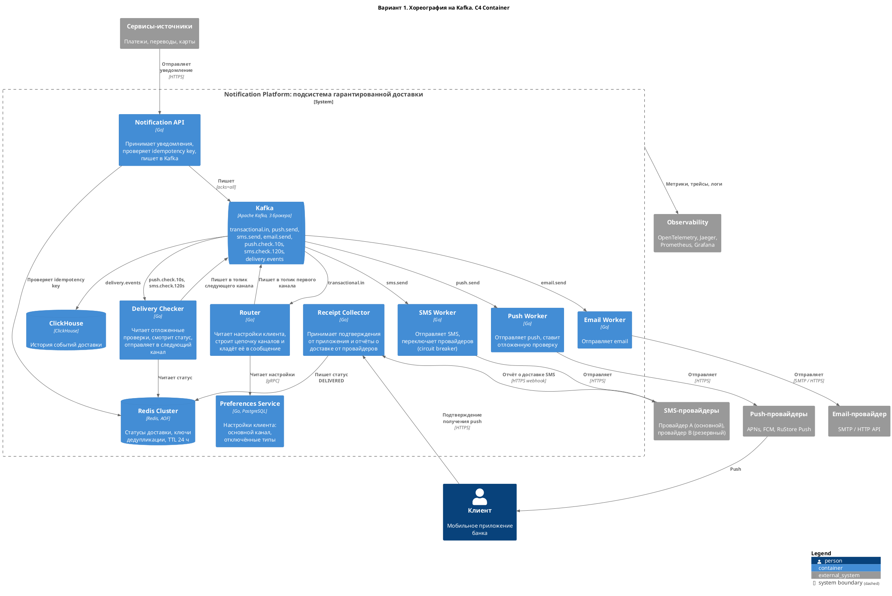
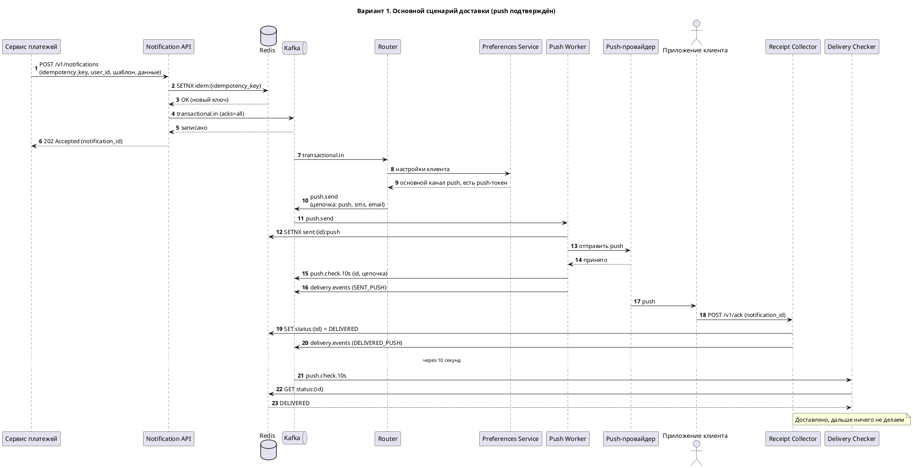
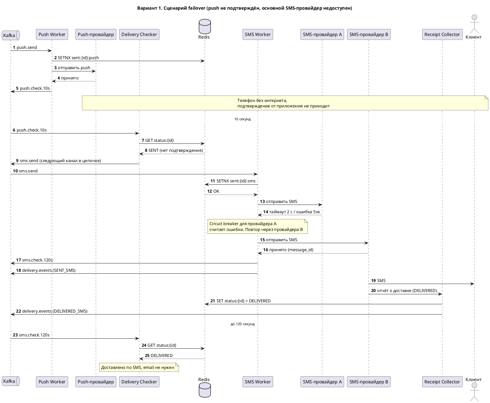
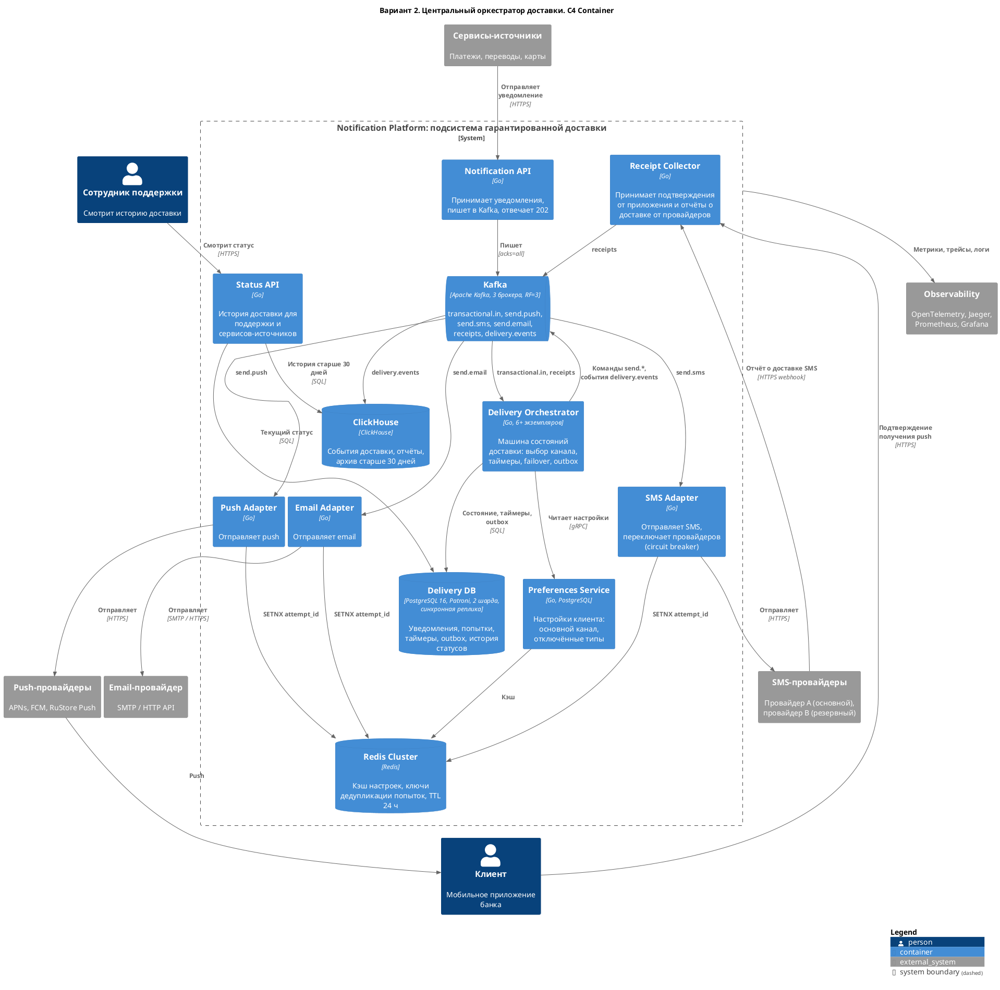
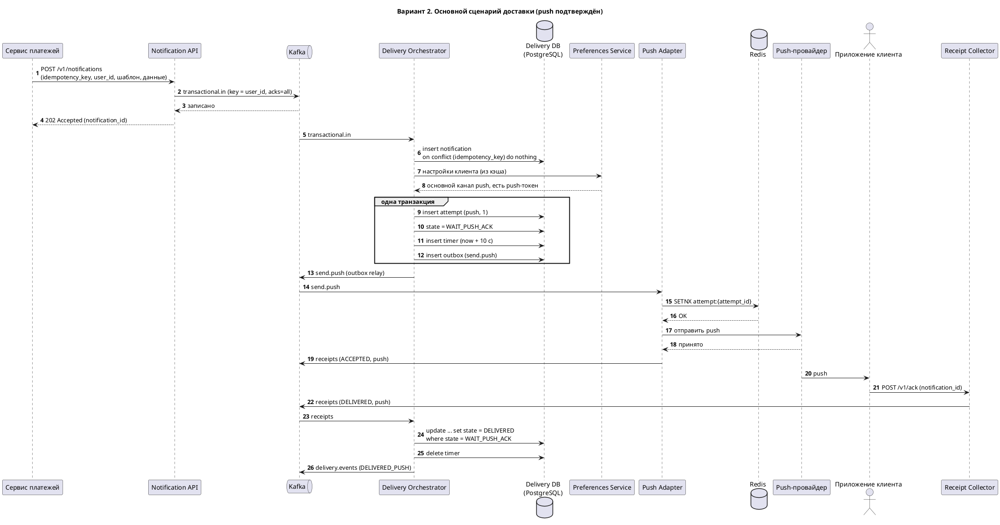
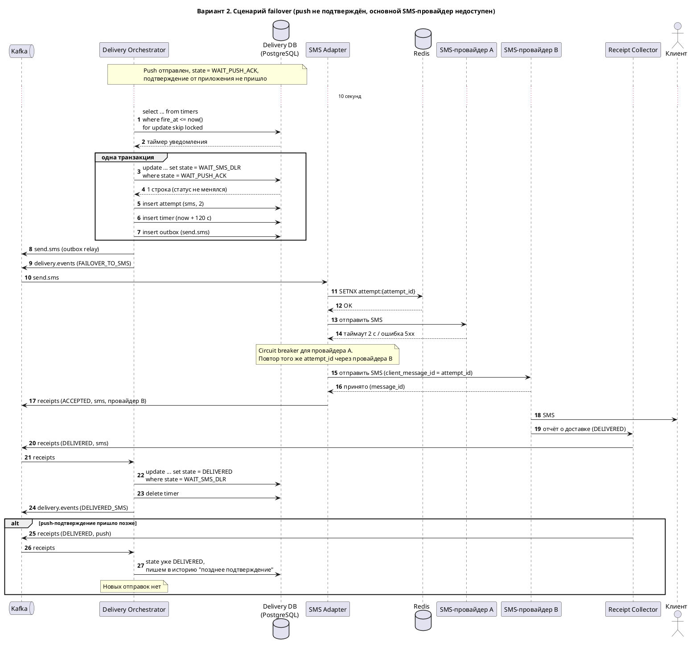

# RFC: Гарантированная доставка критичных уведомлений с кросс-канальным failover

| Метаданные | Значение |
|------------|----------|
| Статус | DESIGN |
| Автор(ы) | Антропова Яна |
| Ответственный | Антропова Яна|
| Бизнес-заказчик | Руководитель направления клиентских коммуникаций |
| Ревьюеры | Архитектор Notification Platform (ожидает ревью) |
| Дата создания | 2026-11-17 |
| Дата обновления | 2026-11-17 |

---

## Оглавление

1. [Контекст](#контекст)
2. [Продуктовый анализ](#продуктовый-анализ)
3. [Пользовательские сценарии](#пользовательские-сценарии)
4. [Статистика](#статистика)
5. [Требования](#требования)
6. [Варианты решения](#варианты-решения)
7. [Сравнительный анализ](#сравнительный-анализ)
8. [Выводы](#выводы)
9. [Связанные задачи](#связанные-задачи)
10. [Приложения](#приложения)

---

## Контекст

Банк строит Notification Platform, через которую проходят все уведомления клиентам (требования ко всей платформе описаны в [README.md](README.md), задания 1-7). Этот RFC описывает одну часть платформы: подсистему гарантированной доставки транзакционных уведомлений.

Транзакционные уведомления: подтверждение перевода, списание средств и похожие сообщения об операциях. Сейчас их отправляет каждая команда сама. Из-за этого уведомления приходят с задержкой, иногда дублируются, а если провайдер недоступен, уведомление теряется.

У каждого канала свои свойства:

| Канал | Надёжность | Стоимость | Задержка | Как узнать о доставке |
|-------|------------|-----------|----------|------------------------|
| push | Не доходит, если нет интернета, push выключен или приложение удалено | Почти бесплатно | Около 1 с | Провайдер этого не сообщает. Нужно подтверждение от приложения. |
| SMS | Высокая, но провайдеры иногда сбоят | Дорого (принято 3 руб. за SMS) | 1-10 с | Отчёт о доставке от провайдера |
| email | Письмо может попасть в спам или быть прочитано поздно | Дёшево | От секунд до минут | Только факт, что провайдер принял письмо |

### Ключевые вопросы

Какую проблему мы решаем?
Транзакционное уведомление может не дойти до клиента или дойти с большой задержкой. Нет единого места, где видно, дошло ли уведомление.

Почему это важно сейчас?
Это одна из трёх бизнес-целей платформы (гарантированная доставка критичных уведомлений). Без этой подсистемы нельзя переводить на платформу платежи и переводы.

Кто затронут этим изменением?
Клиенты банка, команды платежей, переводов и карт (они отправляют уведомления), поддержка (разбирает жалобы), команда мобильного приложения (нужно подтверждение получения push).

---

## Продуктовый анализ

Связь с бизнес-целями:

| Бизнес-цель | Как помогает подсистема |
|-------------|-------------------------|
| Гарантированная доставка критичных уведомлений | Уведомление доходит хотя бы по одному каналу, при отказе канала или провайдера отправка идёт по другому каналу. |
| Снизить жалобы на уведомления на 30% | Меньше потерянных и задержанных уведомлений, нет дублей. Поддержка видит историю доставки и быстрее отвечает клиенту. |
| Увеличить retention на 15% | Клиент доверяет банку, когда сразу видит каждую операцию. Это также помогает быстро заметить мошенническую операцию. |

Почему важна стоимость. Если отправлять каждое транзакционное уведомление по SMS, это около 18 млн руб. в день (расчёт в разделе [Требования](#требования)). Если сначала отправлять push, а SMS только когда push не подтверждён, расходы падают примерно в 7 раз. Поэтому подсистема не отправляет во все каналы сразу.

Что считаем доставкой:
- push: приложение прислало подтверждение получения
- SMS: провайдер прислал отчёт о доставке
- email: провайдер принял письмо (последний канал, более слабая гарантия)

Какие уведомления можно отключить (решение автора):
- транзакционные отключить нельзя, можно выбрать основной канал: push или SMS
- сервисные: нельзя отключить статус заявки и напоминание о платеже по кредиту, остальные можно
- маркетинговые можно отключить полностью

В этом RFC рассматриваются только транзакционные уведомления. Сервисные и маркетинговые проходят через другие части платформы.

---

## Пользовательские сценарии

| Приоритет | Тип сценария | Действующее лицо | Сценарий |
|-----------|--------------|------------------|----------|
| MUST HAVE | Основной | Клиент | Клиент сделал перевод. Через 1-2 секунды он получает push с подтверждением. |
| MUST HAVE | Failover на другой канал | Клиент | Push не подтверждён за 10 секунд (нет интернета, приложение удалено). Клиент получает SMS. |
| MUST HAVE | Отказ провайдера | Клиент | Основной SMS-провайдер не отвечает. SMS уходит через резервного провайдера. |
| MUST HAVE | Повторный запрос | Сервис-источник | Сервис платежей из-за сетевой ошибки отправил одно и то же уведомление дважды. Клиент получает его один раз. |
| MUST HAVE | Настройки | Клиент | Клиент выбрал SMS основным каналом. Уведомления об операциях приходят по SMS. Отключить их нельзя. |
| SHOULD HAVE | Статус доставки | Сотрудник поддержки | Клиент пишет, что не получил уведомление. Сотрудник видит, когда и по каким каналам оно отправлено и что ответили провайдеры. |
| SHOULD HAVE | Мониторинг | Дежурный инженер | Доля доставленных уведомлений падает. Приходит алерт, на дашборде видно, у какого провайдера ошибки. |
| COULD HAVE | Ручная повторная отправка | Сотрудник поддержки | Сотрудник повторно отправляет уведомление клиенту по выбранному каналу. |

---

## Статистика

Исходные данные из задания:

| Показатель | Значение |
|------------|----------|
| MAU | 10 млн пользователей |
| DAU | 3 млн пользователей |
| Peak Concurrent Users | 300 000 пользователей |
| Транзакционных уведомлений на пользователя в день | 2 |
| Сервисных уведомлений на пользователя в день | 3 |
| Маркетинговых уведомлений на пользователя в день | 5 |
| Всего уведомлений на пользователя в день | ~10 |

Допущения автора (проверяются в задачах из раздела [Связанные задачи](#связанные-задачи)):

| Допущение | Значение |
|-----------|----------|
| Пиковая нагрузка выше средней | в 10 раз |
| Доля push, не подтверждённых за 10 секунд | 15% |
| Доля SMS, по которым пришёл отчёт "не доставлено" | 2% |
| Стоимость одного SMS | 3 руб. |
| Стоимость одного push | около 0 руб. |
| Размер одного сообщения в Kafka | ~1 КБ |
| Срок хранения истории доставки в PostgreSQL | 30 дней, дальше в ClickHouse |

---

## Требования

Требования ниже детализируют требования из заданий 1-3 ([README.md](README.md)) для подсистемы гарантированной доставки. В колонке "Источник" указано, из какого требования README они получены.

### Функциональные требования

| № | Приоритет | Обозначение | Требование | Источник |
|---|-----------|-------------|------------|----------|
| 1 | MUST HAVE | FR1 | Принимать транзакционное уведомление от сервиса-источника и отвечать "принято" только после надёжного сохранения. | FR-1, FR-2 |
| 2 | MUST HAVE | FR2 | Доставлять уведомление хотя бы по одному каналу. Доставка подтверждается: для push приложением, для SMS отчётом провайдера, для email приёмом письма провайдером. | FR-2 |
| 3 | MUST HAVE | FR3 | Выбирать первый канал по настройкам клиента. По умолчанию push. Если клиент выбрал SMS, то SMS. Если у клиента нет рабочего push-токена, то SMS. | FR-3 |
| 4 | MUST HAVE | FR4 | Если канал вернул ошибку или подтверждение не пришло за заданное время, автоматически отправлять по следующему каналу. Порядок: push, затем SMS, затем email. Время ожидания: push 10 с, SMS 120 с. | FR-2 |
| 5 | MUST HAVE | FR5 | При отказе провайдера переключаться на резервного провайдера того же канала. | FR-2 |
| 6 | MUST HAVE | FR6 | Не отправлять одно уведомление по одному каналу больше одного раза. Не отправлять по следующему каналу, если доставка уже подтверждена. Повторный запрос с тем же idempotency key не создаёт новое уведомление. | FR-4 |
| 7 | MUST HAVE | FR7 | Транзакционные уведомления нельзя отключить. Клиент может выбрать основной канал: push или SMS. | FR-3 |
| 8 | SHOULD HAVE | FR8 | Показывать историю доставки каждого уведомления: каналы, провайдеры, время, ответы провайдеров. | FR-7 |
| 9 | SHOULD HAVE | FR9 | Если ни один канал не сработал, помечать уведомление как недоставленное, создавать алерт и повторять SMS ещё 3 раза с интервалом 5 минут. | FR-2 |
| 10 | COULD HAVE | FR10 | Давать поддержке повторно отправить уведомление по выбранному каналу. | FR-7 |

### Нефункциональные требования

| № | Приоритет | Обозначение | Требование | Источник |
|---|-----------|-------------|------------|----------|
| 1 | MUST HAVE | NFR1 | Доступность приёма транзакционных уведомлений 99,95% в месяц (не больше 22 минут простоя). | NFR-4 |
| 2 | MUST HAVE | NFR2 | Задержка основного сценария: от приёма до передачи провайдеру p95 ≤ 2 с, p99 ≤ 5 с. | NFR-1 |
| 3 | MUST HAVE | NFR3 | Задержка при failover: передача уведомления резервному каналу не позже 15 с после приёма (p99). | NFR-6 |
| 4 | MUST HAVE | NFR4 | Надёжность: 0 потерь принятых уведомлений (RPO = 0). ≥ 99,9% уведомлений доставлены хотя бы по одному каналу за 5 минут. | NFR-3 |
| 5 | MUST HAVE | NFR5 | Масштабируемость: 2 000 уведомлений в секунду (это пик 700 в секунду с запасом в 3 раза). Дальнейший рост закрывается добавлением экземпляров и шардов. | NFR-5 |
| 6 | MUST HAVE | NFR6 | Дубли: повторная отправка по одному каналу ≤ 0,01% уведомлений. Клиент получил и push, и SMS: ≤ 2% уведомлений. | NFR-8 |
| 7 | MUST HAVE | NFR7 | Наблюдаемость: логирование, метрики, трейсинг. У 100% уведомлений есть trace id и история статусов. Алерт, если доля доставки за 5 минут ниже 99% или доля ошибок провайдера выше 5%. | NFR-7 |
| 8 | SHOULD HAVE | NFR8 | Стоимость: по SMS уходит не больше 20% транзакционных уведомлений (у клиентов с push по умолчанию). | Бизнес-цели |
| 9 | SHOULD HAVE | NFR9 | Отказ одного экземпляра сервиса, одного узла БД или брокера не останавливает доставку дольше 1 минуты (RTO ≤ 1 мин). | NFR-4 |

### Архитектурно значимые требования (ASR)

ASR-1, ASR-2, ASR-3 и ASR-4 взяты из задания 3 и уточнены для этой подсистемы. ASR-5, ASR-6 и ASR-7 добавлены в этом RFC.

| ASR | Название | Приоритет | Связанные требования | Почему влияет на архитектуру |
|-----|----------|-----------|----------------------|-------------------------------|
| ASR-1 | Гарантированная доставка (ASR-1 из README) | Высокий | FR1, FR2, FR4, FR9, NFR4 | Нужно надёжно хранить уведомление и его статус до подтверждения, иметь подтверждение по каждому каналу и повторять попытки. Определяет брокер, БД и модель обработки. |
| ASR-2 | Низкая задержка (ASR-2 из README) | Высокий | NFR2, NFR3 | Мало шагов и синхронных вызовов на пути уведомления, кэш настроек, отдельный поток. |
| ASR-3 | Устойчивость к отказам провайдеров и каналов (ASR-4 из README) | Высокий | FR4, FR5, NFR3, NFR9 | Нужны таймеры ожидания подтверждения, circuit breaker, несколько провайдеров и место, где принимается решение о переключении. |
| ASR-4 | Изоляция от массовых рассылок (ASR-3 из README) | Средний | NFR2, NFR5 | Отдельные топики и обработчики для транзакционных уведомлений, отдельные лимиты у провайдеров. |
| ASR-5 | Нет дублей при повторах и failover | Высокий | FR6, NFR6 | При гарантии "не меньше одного раза" повторы неизбежны. Нужны ключи идемпотентности, условное обновление статуса и одно место, где видно, доставлено ли уведомление. |
| ASR-6 | Наблюдаемость процесса доставки | Средний | FR8, NFR7 | Статус и история должны быть доступны в реальном времени. Нужны сквозной trace id, метрики по каналам и провайдерам, хранилище событий. |
| ASR-7 | Минимальная стоимость доставки | Средний | FR3, FR4, NFR8 | Нельзя отправлять во все каналы сразу. Нужно сначала ждать подтверждение push, а это конфликтует с ASR-2. Определяет порядок каналов и время ожидания. |

### Расчёт нагрузок

```
Транзакционные уведомления
  В день:          3 000 000 DAU x 2 = 6 000 000
  В среднем:       6 000 000 / 86 400 с ≈ 70 в секунду
  Пик (x10):       70 x 10 = 700 в секунду
  Проверка через Peak Concurrent Users:
                   300 000 онлайн, 10% делают операцию в течение минуты
                   300 000 x 0,1 / 60 ≈ 500 в секунду (тот же порядок, что 700)
  Проектируем на:  700 x 3 (запас на рост и всплески) ≈ 2 000 в секунду

Все уведомления платформы (для контекста)
  В день:          3 000 000 x 10 = 30 000 000
  В среднем:       30 000 000 / 86 400 ≈ 350 в секунду
  Рассылка 1 млн за 30 мин:  1 000 000 / 1 800 ≈ 560 в секунду
                   (идёт по отдельным топикам и обработчикам)

Попытки по каналам (транзакционные)
  Push:            6 000 000 в день, до 2 000 в секунду
  SMS (15% push не подтверждены):
                   6 000 000 x 0,15 = 900 000 в день
                   в пике 2 000 x 0,15 = 300 в секунду
  Email (2% SMS не доставлены):
                   900 000 x 0,02 = 18 000 в день
  Попыток на одно уведомление в среднем: 1 + 0,15 + 0,003 ≈ 1,15

Стоимость SMS в день
  Только SMS:      6 000 000 x 3 руб. = 18 000 000 руб.
  Сначала push:    900 000 x 3 руб.   =  2 700 000 руб.
  Экономия:        ≈ 85%, примерно в 7 раз

Kafka (транзакционные топики)
  Сообщений на одно уведомление: приём 1 + команда отправки 1,15
                   + квитанции ~2,3 + событие для истории ~2 ≈ 6,5
  Пик:             2 000 x 6,5 = 13 000 сообщений в секунду ≈ 13 МБ/с
  Для Kafka из 3 брокеров это небольшая нагрузка. 24 партиции на топик.

Redis (ключи дедупликации, TTL 24 ч)
  6 000 000 x 1,15 x ~100 байт ≈ 0,7 ГБ

PostgreSQL (вариант 2)
  Записей в БД на одно уведомление: уведомление 1, попытки 1,15,
                   смены статуса ~2, таймер 2 (создать и удалить),
                   outbox ~1 ≈ 7
  Пик:             2 000 x 7 = 14 000 записей в секунду
  2 шарда:         ≈ 7 000 записей в секунду на шард
  Объём:           запись ~1 КБ + попытки ~0,6 КБ ≈ 1,6 КБ на уведомление
                   6 000 000 x 1,6 КБ ≈ 9,6 ГБ в день
                   30 дней ≈ 290 ГБ, с индексами ≈ 450 ГБ (≈ 225 ГБ на шард)

ClickHouse (история старше 30 дней)
  ~13 млн событий в день, со сжатием ~1-2 ГБ в день, ~0,5 ТБ в год
```

---

## Варианты решения

Общее для обоих вариантов:

- Сервис-источник отправляет уведомление в Notification API с idempotency key (например, id операции и тип уведомления) и сразу получает ответ 202. Он не ждёт отправки.
- Транзакционные уведомления идут по отдельным топикам Kafka и обрабатываются отдельными экземплярами сервисов. Маркетинговые и сервисные уведомления используют другие топики и другие пулы обработчиков (ASR-4).
- Мобильное приложение после получения push отправляет подтверждение с notification_id и показывает уведомление с одним notification_id только один раз.
- SMS отправляются через двух провайдеров. Провайдер A основной, провайдер B резервный. Для каждого провайдера работает circuit breaker: если за 30 секунд больше 20% ошибок или таймаутов (таймаут 2 с), трафик идёт на провайдера B.
- Технологии: сервисы на Go в Kubernetes, Apache Kafka, Redis Cluster, ClickHouse, OpenTelemetry, Jaeger, Prometheus, Grafana.

### Вариант 1: Хореография на Kafka без центрального оркестратора

> Описание: каждый канал сам отправляет уведомление и сам передаёт его следующему каналу, если доставка не подтвердилась. Цепочка каналов записана в самом сообщении. Состояние доставки хранится в Redis.

#### Архитектура

![v1-c4-container](https://www.plantuml.com/plantuml/svg/ZLVTJzjM57_tNt77Kv12EZgUfcqg3IdjHY5DqFg87ES2LXmxyWSqcYQLC8rDcOhOqpHjHNsOzke2xanImhzmxt-qSuu_OfjGU8djUy_NFUTtVkVcaUEgjkjr3RQtkA0jBMYMwQgwoMtbCztK3A_DsLVLfGVLfQrgilEDehYwQt0cVXU-V2r2uOihEM2B5IR-4HDO2SH4dCFJbp-9K1upSILyzfswtL4hhBh4KakAKkUsOvabpT2vwPRPdFXJZC5WW0RdyFilCFKULiRoDx0o4G4Jr-Hp31yVK1356SX0468a_BbvfTbtNDxTghroIuwjePLt8W2bCmZcG0uNw360I8z8UoH2SdKADdrO3y1kM0O_f1I0saHSo26iZF2ySY27UISzpzdjWOKwF1Sel0ae-U9INA0948VDvVgwKsPFgi_BhE4rNSlc3EKBuNOTDDHythpLZZWjhhDbLeB3751-pkZtShxCRXfWZrc9JlHVd8uhEGJHV0Yyg-e61b73bnbXp560ctNsW3tTXCTo_HbOI4myjZophThzaeasrYrNtzOrrTKjazKDrTssxEwNc5fCwK5SY41y17o8Sq8JOGas4gzNqO4OE9-Gj0_BMB9vzeF2fbWggJszw153WxLLAqrSI1K7Tt2I0PE7O2j0ox0qZi0aZpEfmwmVawZUvjsUvN9JwxCExnCyGlaBxOcp2DoGXan0BppkyL87Dy1x980uwAdQBeyKokmBG2xv6b59V9HmRTLqL0rFe1eLtImp15Z5uMQxp00XyHiLAdud0J2hTIgBdpkHLFpv4B_RtD3tkDsly3teCoSVQCcsF9VRuBb1BvcK_Gjd7CJ9mYR60b2ubrW2R8YqMuLVPkbsYCdz6JQkgSj6yf2Q1qrGuvwnHDi779oWzK2UO28151DiUVbhqjk5O7isttQmsU39RQW7TrYJstkwngF0ownkEUwEpPilrkWGVzyHD-2nq3sPOCkuEK05-KOUoHF48tHDm12aW9DXCJoen7xC1UobPNTo-NmBMjS4yZCm624BDQBKqJAcZbnE2UvA7ietEL1YHWkEeUJx4NNSpoq8PZWkFbzIwXjDJpKhQRgjURhBMZPNmSDy8GH2v7v27VSBWtGATWYv1CYL6BUi6YtT1irYleR9d4ZpXOmEHVw8eiW3251AENmUoeEupCNe8a0YCrnW3G2KOGuTnKR2OTFW6jTxBYmR1jU0w3z9GJ4L3k8uFs2w8ngYY6PCEzm9QHFnYDC8Fehq66IqRnGo7_LAgsJpjkvGwF1aLSDpOXfeH1lB6qye_7VJXA7N0YFJW8nW538w1oGDpZUc6Ui37uGejBcvnXukCNbq8mmD-c2kQkXQvwdbETJE-I_nHpouNrCQY2lUoo6rugm9eVoeP4URrS93RhGSe0krfHkwsqUh6prkRdA3Txbh0x5_g_8T15_Tjc1bbtkWj6ghswg91Ayqk17TAg9vCnFKi-OA41c8uyHiWXcqGWQIrATZ_TQHazLAfWhSMU8XXCPLhUDyhHf6B1aBfUnUd2knMBAV4EiTf8-ETXhrQa7xPaJKF50i79HYb50DNgRE4Q_JSU3duqqOD1rw-UsOvv8vcDzC6MWw76E1s6foLPjLjc9z8a_nbUm-2edtz0frcrBc-jJCn0SgwKKulXlYLh8MNMLFP_C54HviZQ4vZrAYGAipZjLBZBrDI6GcXS28I9NPFc_jMbOdARkMXMvQyYobifNQshFlQutQIhv6KtR_zAqbENqYdhhBuZFhiAXm9oGBr1xS0KoYfvitAPJ0osx4Bl279OWcJ3np1ZHVBv4nWI371F-GBinFDrvkhTLMQ-ihfNdb4K0L_eKf_mC0)

<details>
<summary>Код диаграммы (PlantUML)</summary>



</details>

Контейнеры:

| Контейнер | Что делает | Технология |
|-----------|------------|------------|
| Notification API | Принимает уведомление, проверяет idempotency key в Redis (SETNX), пишет в топик transactional.in, отвечает 202. | Go |
| Router | Читает настройки клиента, строит цепочку каналов (например push, sms, email) и пишет сообщение в топик первого канала. | Go |
| Push Worker, SMS Worker, Email Worker | Отправляют уведомление провайдеру. Перед отправкой ставят ключ sent:{id}:{канал} в Redis (SETNX), чтобы не отправить дважды. После отправки пишут отложенную проверку в топик push.check.10s или sms.check.120s. SMS Worker переключает провайдеров. | Go |
| Delivery Checker | Читает отложенные проверки. Kafka не умеет задерживать сообщения, поэтому Checker сравнивает время сообщения с текущим и ждёт нужный момент. Если в Redis нет статуса DELIVERED, пишет сообщение в топик следующего канала из цепочки. | Go |
| Receipt Collector | Принимает подтверждения от приложения и отчёты о доставке от SMS-провайдеров. Пишет статус в Redis и событие в delivery.events. | Go |
| Preferences Service | Хранит настройки клиента. | Go, PostgreSQL |
| Redis Cluster | Статусы доставки и ключи дедупликации, TTL 24 часа. AOF с записью на диск раз в секунду. | Redis, 3 мастера и 3 реплики |
| Kafka | Все топики подсистемы. Репликация 3, min.insync.replicas = 2, acks = all. | Apache Kafka, 3 брокера |
| ClickHouse | История событий доставки для поддержки и отчётов. Собирается из топика delivery.events. | ClickHouse, 2 шарда по 2 реплики |

#### Основной сценарий доставки

![v1-seq-main](https://www.plantuml.com/plantuml/svg/TLNTJjim6BttKtpYgfMQGBci1091jI4cg2ZxkPY4J6f4r3G9iTC9JKYZayQaeKsRThrfRz1r15gwbbTmtcYVdRHDMdRHohMFZyztV3vtWmiQYB3bGBjiS7PcjAZj4c4BXu7y9hlnEzcNNJcAEr0sGVw8B-L8ZcLFVmyWlem_o0X_9C01o1ivniaExkd9Uzc7WX_oKv0F2B_1wPwC47cBuwzoL2Gq59uRjevPG8YFGcpBzgahO4d-qi2UxCUNQlSGJ-ZWIRVu6Im1vS03AxzbpnFsYMrHONikRDPsD8hwDcbGGOyfPx1qm1esr_E16f6pa8KulKjFcbHFDzKeJtlWXO85oIOzp2_N0dR20kPQZ4ET1MtROXhhupoVWoedNdf1CwLJphnPX1Zo0IjN7dVb0Fr47wPmdr1BU07wyrCRFaJShRw0lem03H-gWReksKthz-VAOHQpVG5RdkCmnPLKDkVbDdFiDWlEOUkKMHEzLZ8c1Aq7Orrv2nMexTSFORbTNdOp_lFNRi5ki9Rl2RJc_AZ9paiGSXOSsOqIn1-njDzQ_AYa8eC1GysVP8I9G5BarlU3xFNguTuhK5ILjtE45oG16LCf-xjGIEA9N0DjH_mvlfgIwjj5d0Yeoz5854eTqtQXGAqcNwEEKoG9PiOfxr3TWugXLZbEk71PcL21rPLLsBGivWlMW4BM0goqI2Pqwsbs7ZcSf2k8qPbHPwf-mYRICHZeDifVBKcGHfPNzLskDt6BKjoLGnqTD3hIfDVwfu4yOuGWOqR1n265C3bp6tYFkiEnV-ChnLX9oNYBbu3XQ-5agzIHpkudoSp2ZUAQK3TwKL606Kg7FAcce_kWgz-0YMgIh1kPepIgZxvyKHNDc7AbwEYQvHKE1Ht0N4d5nKsDDFycQwDGt5MlxXqUrPxNdsArgGQL43yzWAYXAjBATWIcwf5C9CsJiGFm3HOXrtR06cnNd-syg1vKjrFaVpLDWHDXfca2bgGUpaZUGNa5tsSStSVlCGStWCkpcqgRUS4WCbd8Q7oIrvZfkndBJ3KMpC13fPbL-Jtpjp3K3zOuxVnXV8tlGQH2trVYvHyvLZyYjHofXn-__v8D31F-JP5_)

<details>
<summary>Код диаграммы (PlantUML)</summary>



</details>

#### Сценарий failover

![v1-seq-failover](https://www.plantuml.com/plantuml/svg/dLLTJnDH47s_lsBIfpPfAoNnXKJ2LsCCYeOIzO64RBSNsT0lzWCqnaIBYYP6Wl795wE_e12AXTho5-x-8y_StUrkQI74XxPtxvoPFJDpPZhdk8RjUhKgxHPoZjp9RHfMjR4hRU5QRbMI-gRQ_blLLMtLzrjKo9FwvNzK7TKFxyyfyg1qqtEs29OEgKirKAT-Ivse3c1dE1-fVfRKm7y7m03t_7rEfKUbdBe4XA_QwboTieCEWYFGVilVHpIyC2CCpstKlLePxCIE9pr9gMLZSzj8aU7GDfz44zbOfjKqwYwbdZ2VPmrxMzeQmlpsnY4J20pXpL7uagnQIFKLBMv9Cmfh1cTHCLoZR3XWjIehbgDjDfz6Oo3b92cdvkoD0IRLP3w26xU2BqJmyYXyLPhIQhgqsAXMfUas0XQsAGn-e9JweNheQuVx7QHNjMJT5K8Nc7ApGHbfHl_c7LclYE069fqkJANYsifpWisTUMrLtimm84RfmWA5_hOqypQOTz7fBpG4DYcNU9L6TK7f41w3E5B0AQIY-v0lJ3cYtd0bQKtgKDam1mxq6vdrKA3tA5UVr34U_v0EtT9IXV1mQcVNw-CQrhBlihn1FEBK0-eiiFY7aVhPudzWVyvBY7m-JuKfWlWxwWA2xgjJmbrSqr13uwb4XaHnxnVN26FhUeukhWZkSoDHIiMLDKe7sT1rcVY7cMJyg9ZGZ6uhfS6tnuFex_jV_SzwsjK5hm9yUgHEIAy2HFSFSD_994J2iax44lhv1eN0daWaz7wyFFHZtK-M3FGlj3NXo2t49Fp5ajf70QPHURh3pf-Gn37dG7TVlape9FHRj6pJirmgszBWgg1IFUxgs7WXmFnw7UlfW5dWNjSvZj_5elp9BgnNJ2DmxAN5DYdOGZBHyes9bfE9ZWu6fMlISOmNSiEgP8OHatqDXJKDPLqrLyBTbfUxw8f3QTRG1bwAjWQldOtdAEQ2bfeXN__0Fz9be6XtQ_PG1gMNYWyVF2sk5fSo0lXH8IJLJFTe20sHrn8S0aEMF6NyPa9-jvgrAnNvprcB-SPwYgtgUw8KFJru0psHNCCioHh-FiErqGTRlKh474O6VyhY7m00)

<details>
<summary>Код диаграммы (PlantUML)</summary>



</details>

#### Как решение выполняет ASR

| ASR | Как выполняется | Итог |
|-----|-----------------|------|
| ASR-1 Гарантированная доставка | Сообщения хранятся в Kafka с репликацией, поэтому принятое уведомление не теряется. Но итоговый статус хранится только в Redis, а он может потерять последнюю секунду записей. Нет одного места, где можно проверить, что каждое уведомление пришло в конечный статус (доставлено или нет). Зависшие уведомления сложно найти. | Частично |
| ASR-2 Низкая задержка | На основном пути нет записи в базу данных, только Redis и Kafka. Ожидаемая задержка до провайдера около 0,5 с. | Да |
| ASR-3 Устойчивость к отказам | Circuit breaker в SMS Worker, переход на следующий канал через Delivery Checker. Но время срабатывания проверки зависит от отставания Checker при чтении Kafka. После перезапуска или при большой очереди переход на SMS может опоздать больше чем на 15 с. | Частично |
| ASR-4 Изоляция от рассылок | Отдельные топики и отдельные экземпляры обработчиков. | Да |
| ASR-5 Нет дублей | Ключи SETNX в Redis. Если Redis потеряет ключи при переключении мастера, возможна повторная отправка. Между чтением статуса и отправкой SMS может прийти подтверждение push, и клиент получит оба сообщения. | Частично |
| ASR-6 Наблюдаемость | Трейсы через OpenTelemetry, история в ClickHouse с задержкой около минуты. Текущий статус нужно собирать из Redis и событий. | Частично |
| ASR-7 Стоимость | Сначала push, SMS только если нет подтверждения. | Да |

#### Этапы реализации

| Этап | Описание | Планируемый срок | Ресурсы | Риски |
|------|----------|------------------|---------|-------|
| 1 | Notification API, Router, Push Worker, SMS Worker (один провайдер), Redis, топики Kafka | 4 недели | 3 backend-разработчика, 1 SRE | Задержка интеграции с провайдерами |
| 2 | Подтверждение push в мобильном приложении, Receipt Collector, отложенные проверки, Delivery Checker | 3 недели | 1 backend, 2 мобильных разработчика (iOS, Android) | Старые версии приложения не присылают подтверждение |
| 3 | Второй SMS-провайдер, circuit breaker, Email Worker | 2 недели | 2 backend | Разные API у провайдеров |
| 4 | История в ClickHouse, трейсинг, дашборды, алерты | 2 недели | 1 backend, 1 SRE | Сложно собрать статус из разрозненных событий |
| 5 | Нагрузочное тестирование на 2 000 уведомлений в секунду, пилот на 5% трафика | 2 недели | 1 QA, 1 SRE, 1 backend | Отставание Checker при пиковой нагрузке |

#### Преимущества
- Нет центрального компонента, каждый сервис простой и независимый.
- Меньше задержка на основном пути, нет записи в базу данных.
- Меньше инфраструктуры: не нужна шардированная PostgreSQL.
- Быстрее разработка (около 13 недель).

#### Недостатки
- Логика failover разбросана по нескольким сервисам. Чтобы поменять порядок каналов или время ожидания, нужно менять несколько сервисов.
- В Kafka нет отложенных сообщений. Точность таймеров зависит от отставания Delivery Checker.
- Состояние хранится в Redis. При сбое Redis возможны лишние SMS и дубли.
- Нет одного места с текущим статусом уведомления. Поддержке и мониторингу приходится собирать его из событий.
- Сложно найти уведомления, которые зависли и не пришли в конечный статус.

---

### Вариант 2: Центральный оркестратор доставки с состоянием в PostgreSQL

> Описание: один сервис (Delivery Orchestrator) хранит состояние каждого уведомления в PostgreSQL, выбирает канал, ставит таймеры и принимает решение о failover. Адаптеры каналов только отправляют сообщения провайдерам.

#### Архитектура

![v2-c4-container](https://www.plantuml.com/plantuml/svg/ZLTRJzn657xVNt6wJqjhI4fG7gAc2bbeqZQ13OlKlg5Pxm0MnbxPNXfKLKg8KbBH1BLFLTGcQYkrhviDJfQbWRzW_wEUSsR6-B8e4H9hpvpBD-VodV6DC191rDzsOMTssfwRjdql4eudWzf7ZcUx_Qw4pvfpbvfpQqspytcj5ZcHAo7vDHca3v9HCaZUfNimEmF9FqbCpxWwI4xId_7v83c6v1GNnacSFbHRwHwjG7A4FxY4iaFS7ir0SmuoDxLQImQXxpLirv5UP44zUPwSe3VsKAVttvFJv1Mki2TyZY4vOq0d-FA614aSK0OHeeT1VSeO3VkzdX-mrJyH1S9A7o4UKXYZ5TG_mhyOhRqXQ7Kb-9yIJKPuNFptK1q4dvvL3eEkshjX9BVN5kz7ZJ2mbGMoE6JLW-dCmhxogzsyHFWKeXXTZom2GqengY6ez01NnXHt179GTDBhXvizjD32tscEn2ag3P9ZTH8Knytvrb9emHVDknQizDkH7qWW-HBSxP0CjU-sBxIJl2olmpmqA0QSYY7_Fvwoe6e0RaA3J_HMXuEhPAe8GMuBnoKGY_Gm0KQT0Qwsu1BSNiMV-TQNQC6OkEdtlQu8TXiUsLZo8sVTiKNa-1wqN16j-y7sDPrdHAmI4MD-1v2yvghcciODu_MTEj24FCFtDJWlsuReEMMF10tNRlbPu4QSSNI79za3BBqXUaVBk7IYwZOzvDIFqYSiaWpXQx6-9IngfZqInwfHshENP_7WEGZt-h8l6rjAlCvgdFcUi3UbCNC5su8FD-Oa3B0SlhX-XUIYG7YXi0cvS6SSpu9GUjqPgYxzYEMXdpXB5WJIbaulmjMkT9qT6UpEo1rish08hE47DjgeBsWXMCPt6Q93h4CL8GkkVWBfKqJrblDnXirzg9AWMtw04Q7m3G0JTwexw93ZMSqEvdY8nVLAySsOypYW_hA0XOxH1PUq1Uju4XzHMU3teuv_lmXzeTFeRUIXBzmaF2q_Z3O2sRvt1pwzQa5BH87lOVvd0L5I6HsnguU4E7tCvw126gI7m1rmnen6p4I7-_l2CZZ5-Zz0n6DYX39oXTSgCX8wu3WWJJoYG67yYhde1N8zf2FWhmoaPyiGsZBOSMnfKd5-EeRt1rfJ38wDG50eeXaZ9uDhK6x_NCXruQ92-YpTJt-XE61cOZhDY4vNYNSWkmu1NA5VQBfzR6ok4bvWHC_Jf-aJu80QO74oPePaDmJnY4AA7PQ5ElqHVqVvg9wIpkhg7PYTWtI_72UiUw5P5UQxegTHw6v-WVfdp1T3AbNko9uYrBmLR1cX6FK3RQ1aZllDULJ7LycGtg1XEu7TToBe159ioM2gX86RLHXA_K0Sh5GonCDiHVKyBhkkjBC6le3YDDKgvgAXUcJgc-jYmk2cdH5lKhdGjCENSeF7EUrAGCefY4JKfu9gyqE9bNyhz4wPHsZXXDOhDmC2YKMVpNLoN9ti5JHOtqo5JTUnjsxx_P2RhlX6DnCawGEUGrLCLY4u-4QNWiVeRcXQ_m4D3xXo6VXc4oV7YE67MdxA-XqAo78dnCON7STrebtolDoJtgfqvRQCWbqBlX9oWuYn5VYuiYafYhS2iIuyGIDtHRhgWgD6tyGocZJYafXyqV1kencomWRCuCABa9v-92RihV2wS5qjgONqGAcEB3EHjBYIOmRd-rv-QiGNCIhVC93x2YOqQoR_qYNG5FUxCZEIwiPAgwbrjPPXDCLR1RlPePzpX8WqyQwdXkp7F47ofL2TihcO6CBAfdPnMpEH6UJ5pOmYpgUxEOAoQexGNbnT-XP4X8NKYzQShfPInjyZP9oyHqnxDBVQIMLLhX_bNjzUFqJ1GCbkcnSfvMwQxHm-LCa-JrhdeJPhwjR_SZBryUSARftWWDxFE8yJLZrMpnXxOLf-8XlYrCYKuJlPsVJzBMs4r4sLbRf3BtChJIwjx7Cf8z7Irr3-ib61htLK-_r5ump5Vk8BMrdllD-C5gCgqVE5_5QmG5T_HN1uROmLL7E3ugbwJ9zXI9mqTLxp9rkjVNlvcxKxYxSMbnOQKxKRs0NuRLpx7m00)

<details>
<summary>Код диаграммы (PlantUML)</summary>



</details>

Контейнеры:

| Контейнер | Что делает | Технология |
|-----------|------------|------------|
| Notification API | Принимает уведомление, пишет в топик transactional.in (ключ партиции user_id, acks = all), отвечает 202 с notification_id. | Go |
| Delivery Orchestrator | Машина состояний доставки. Создаёт уведомление в БД (уникальный idempotency key), выбирает первый канал по настройкам, создаёт попытку, таймер и команду отправки в одной транзакции. Читает квитанции и таймеры, переводит уведомление в следующий статус или на следующий канал. Команды в Kafka публикуются через таблицу outbox (transactional outbox), поэтому команда не теряется при падении сервиса. | Go, 6 и больше экземпляров |
| Delivery DB | Таблицы notifications, attempts, timers, outbox, status_history. Шардирование по hash(notification_id). | PostgreSQL 16, Patroni, 2 шарда, у каждого синхронная и асинхронная реплика |
| Push Adapter, SMS Adapter, Email Adapter | Отправляют уведомление провайдеру и пишут ответ провайдера в топик receipts. Перед отправкой ставят ключ attempt:{attempt_id} в Redis (SETNX). SMS Adapter переключает провайдеров и передаёт провайдеру attempt_id как client_message_id. Логики выбора канала в адаптерах нет. | Go |
| Receipt Collector | Принимает подтверждения от приложения и отчёты о доставке от SMS-провайдеров, пишет их в топик receipts. | Go |
| Preferences Service | Настройки клиента, кэш в Redis. | Go, PostgreSQL, Redis |
| Status API | Текущий статус и история доставки для поддержки и сервисов-источников. | Go |
| ClickHouse | События доставки для отчётов и история старше 30 дней. | ClickHouse, 2 шарда по 2 реплики |
| Kafka | Топики transactional.in, send.push, send.sms, send.email, receipts, delivery.events. Репликация 3, min.insync.replicas = 2. | Apache Kafka, 3 брокера |

Статусы уведомления:

```
NEW -> WAIT_PUSH_ACK -> DELIVERED
NEW -> WAIT_PUSH_ACK -> WAIT_SMS_DLR -> DELIVERED
NEW -> WAIT_PUSH_ACK -> WAIT_SMS_DLR -> WAIT_EMAIL -> DELIVERED
                                                  -> FAILED (алерт, повтор SMS 3 раза)
NEW -> WAIT_SMS_DLR (если клиент выбрал SMS или нет push-токена)
```

Как работают таймеры. Каждый экземпляр оркестратора раз в 200 мс выполняет запрос:

```sql
select notification_id
from timers
where fire_at <= now()
order by fire_at
limit 500
for update skip locked;
```

`skip locked` позволяет нескольким экземплярам разбирать таймеры параллельно и не брать один таймер дважды.

Как работает защита от дублей:
- повторный запрос от сервиса-источника отсеивается уникальным индексом на idempotency_key
- повторная обработка одной команды адаптером отсеивается ключом attempt:{attempt_id} в Redis и client_message_id у SMS-провайдера
- приложение показывает push с одним notification_id один раз
- переход на следующий канал делается условным обновлением, которое срабатывает, только если статус не изменился:

```sql
update notifications
set state = 'WAIT_SMS_DLR'
where id = :id and state = 'WAIT_PUSH_ACK';
```

Если подтверждение push пришло раньше, статус уже DELIVERED, обновится 0 строк и SMS не отправится.

#### Основной сценарий доставки

![v2-seq-main](https://www.plantuml.com/plantuml/svg/TLLTJnj757sVNt75arUrdS0ZKgAuOAc8ABYOfdr0GiFkO4QiTpSpiqvHLQdmK5LAgwZz0Qtw3rmK4pi8-0kp_wXdPh6zoyU3hV7CkUVUkUUUyIjjk3BvCARHMakBTwqXbmapqiI2x5zsNFnYftPihujpMckJ_RiuizVsnbxuxnaLPyMlTe8V9N16zfEzmUOvOYxi5pkbHfRhOxAtW7_2zeMT07c9zP_sEc0yDscI3m-5OYn38JAK6KyChTX_FV32Jeip5ts53EV8T8dFR8Mu9gt2UiYRrCWZ6N8ZquGwlIsFufbaxtAH2rhPvaSdt6-Uk5KzU5F4SYJKAUsey5XeexX9bGUds60HD_oGQr41RdwzdpHwgJO39VhVlWuyE1lKQNjA70abab1ewWirag4eSTZNzw2kJvs8PqQKYLtZU2NpheYazYVAhHv6j-mjMkR46TiPX4035qGPuo5kXCR-uvMw0kxIApUr4u9ILsxXTBRZkyPbzGox8XGoCxIHnh48vzs120nAKEkbQpMjKs-dlqVFHglFaeeS6gsIaHXcgK4lJWzEn6cJSYtKWOoQLFo6Wl_p9LqttGHXtb391pl1W80Kt5uni4ENHECcuEHnMoRK01MzM7Bny4I_u74Si3AajIZCVWRlhPidptzJKkFObRzEQy_Ng1E60ksFg54j7hm1czEzzFFmI2NCx-Cy6-1K9YZ8K9LcFy5OXcbo5ClGqFrs11Ib3duiay6Ioas9Aztv2wRowiwyhUgAKGFhpzWi_d3D35WPsLgMwrnPSou8N1l6zihF1_e-yIb-zpzROBq11FnieD8y8-TVXoTVXWjr_Vm2-q-BZupeiUjpOt19Kxu1JLeDxkFm-1W1-RxlREqTzBxhVtFGsTX-Wip8eL1EcVVq5Qq-nzCJF85CStEO_aWDBPAexL873Aj5L-Upj3Ycnbs44Z4_hMhjBLY5id87Hzw3EEftzzxyCB_f-azt2ypCpwo4j2eyEzjB0k_AKfbpRzonV-tc2h3ol1hjKLCe_j6fisIQNqYL3jNKw6niT7jxtSqcbTUVapalk9m-WLkwYuHLry8_Zqn_QV27UJQxhxVUTdUNYUwxP0wjkoFF8gTxkzr6PyrY2XPi-ydxOxoQJun7ZIeIiG363yS3XQExjxejHYAfrUlP0lOAkkA_Z_qF)

<details>
<summary>Код диаграммы (PlantUML)</summary>



</details>

#### Сценарий failover

![v2-seq-failover](https://www.plantuml.com/plantuml/svg/ZLRBJYD75DtNLrnvrQtOJa3A1eNH6DjH42GGJ1uB9Ajibw5bkzlJNMOOHP46HicCb2XeiemKHVa3X-3mCFRyGlKVvTpgzcim2HjJVUk-xpctU1ff6UfUfqt7gxb8FSirfTSEZbKejAVRYiolfX-_DDUcRqRn6QtcoVmP_sW6PfJARsXYGKwt5nqHRWPatfcnkOpFp8KPGEqVdD-QKPRCE3w5mXXo_hsXokULd7a75HRrpOsvP0Fh14TensVnAtX3G5V8dWxyNgU6xCIpdkefocp9PajcI4RKufFeeXglxdMbhobJKcqFYRsWdR1-f28TIXs4LZc0G3IabZKPgJd5qiQ1x-m6aJuCLUNBRTSgTmyNtI9dAZHaLwl4MTI9v9opFTNm8diHykcUxR9w2qaW-IZbZKIvjgYyf-hAwseg1kssgayA3Uj2yWTbp6zcY7aDU8xsgjxsbA-5y0Ejo0wGkv95kRH6ktQKOqoGu_SHVyYcMG9UeBvEtnGszwkxNrK-gnQAMza3__x4BKYk6GnmGzRFDRoCSMTlulC9LlWcViDtGkJpULhvY02JWRd5w4VcaY0Jd1lbdYJPHOfBP3armw13skkeC3hmdn-fK57J2rLLQlfadVpWkUCU-4qqeDTjSEPHo-jIEwYtL4F0LmukhUirGkxSuplROqI-I208mN2Ii3WCWrwNk58c04niSqRc2h-tu0Nh42taciRbN2Eb5_k70LTBstkJn9Vs5luMyrmXomf6nIroSFWBP0HFujEqetTspETcYBjpz_sCF3zIeIQfjUe0C0xmcwNLXzHiRyb19-a3MbdbqJoa6lHqBJY1G-Ktyl3g2XocaxC4jSDBRib9zKFLbY_SUtgDb9HvTGoSGltJmkRspjVblUh-3dVE5I9HXGrJSCwriD-GMmRYebBU_-BRISLhtwM7gjVuNYGgkPcJdQsfUPU_5rXmZJx_p5iBv9itceAdZp5WJw9Bz26RlW7e_xA3-lZaP8vhgLtH2-izJrCjLB85CO0rP6BSOpqS5FAWsHyiHhGnWnH_pDzcJ4mfcXL5yMjhCZ1Noprjp2giFLWXESc6g7PK5Cb3nOxNvwAu0iPpBKWP3jnnNkJCpDnfkCbimsHPOQY5Oh6ykrykPSd2SDcwmw0vqfDqO_4ukVzM5DRJ_EFNyLjUCsEQl1kscbiqnYcLjpU1ctB95T1VciPKnURXpf2LacwYAHx3xQcpfSHEIR_e2M1NKB5a-tycJ0EaF91jJVpuvlvh2y-jsUHzlcBOWCgFw0axPzO_s9Rt5a9IC9Oe0tFcnpuJdCF0t96v89nF4opZz0lUg2IjI_lyB_ilOb9D1W4Ntos6mU-M6p_5FomY6dlIxiNupEwZf_Z1FppYNm00)

<details>
<summary>Код диаграммы (PlantUML)</summary>



</details>

#### Как решение выполняет ASR

| ASR | Как выполняется | Итог |
|-----|-----------------|------|
| ASR-1 Гарантированная доставка | Уведомление принимается после записи в Kafka с репликацией. Состояние, таймеры и команды хранятся в PostgreSQL с синхронной репликой (RPO = 0). Outbox гарантирует, что команда отправки не потеряется. Каждое уведомление обязательно приходит в статус DELIVERED или FAILED. Раз в 5 минут фоновая задача ищет уведомления без таймера в промежуточном статусе. | Да |
| ASR-2 Низкая задержка | Добавляется одна транзакция в PostgreSQL (около 5-10 мс с синхронной репликой). Ожидаемая задержка до провайдера около 0,5 с, p95 укладывается в 2 с. | Да |
| ASR-3 Устойчивость к отказам | Таймеры в БД срабатывают точно (опрос раз в 200 мс), не зависят от отставания чтения Kafka. Переход на SMS через 10-11 с после приёма, это укладывается в 15 с. Circuit breaker в SMS Adapter. Отказ экземпляра оркестратора: его партиции и таймеры забирают другие экземпляры. | Да |
| ASR-4 Изоляция от рассылок | Отдельные топики, отдельные экземпляры оркестратора и адаптеров для транзакционных уведомлений. | Да |
| ASR-5 Нет дублей | Уникальный idempotency key, условное обновление статуса, SETNX на попытку, client_message_id у провайдера. Остаётся случай, когда push дошёл, но подтверждение пришло позже 10 с: клиент получит и SMS. Ожидаем ≤ 2%. | Да |
| ASR-6 Наблюдаемость | Текущий статус и история лежат в PostgreSQL и доступны через Status API сразу. Каждая смена статуса пишется в delivery.events и ClickHouse. Сквозной trace id через OpenTelemetry. Метрики: число уведомлений по статусам, время до доставки, доля failover, ошибки по провайдерам. | Да |
| ASR-7 Стоимость | Сначала push, SMS только если push не подтверждён за 10 с. Порядок каналов и время ожидания меняются в одном месте. | Да |

#### Этапы реализации

| Этап | Описание | Планируемый срок | Ресурсы | Риски |
|------|----------|------------------|---------|-------|
| 1 | Notification API, Delivery Orchestrator, PostgreSQL (1 шард), Push Adapter, SMS Adapter (один провайдер) | 5 недель | 3 backend-разработчика, 1 SRE | Задержка интеграции с провайдерами |
| 2 | Подтверждение push в мобильном приложении, Receipt Collector | 3 недели | 1 backend, 2 мобильных разработчика (iOS, Android) | Старые версии приложения не присылают подтверждение |
| 3 | Второй SMS-провайдер, circuit breaker, Email Adapter | 2 недели | 2 backend | Разные API у провайдеров |
| 4 | Status API, ClickHouse, трейсинг, дашборды, алерты | 2 недели | 1 backend, 1 SRE | Нет |
| 5 | Разделение PostgreSQL на 2 шарда, нагрузочное тестирование на 2 000 уведомлений в секунду, пилот на 5% трафика, перевод сервисов-источников | 3 недели | 1 QA, 1 SRE, 1 DBA, 1 backend | Нагрузка на запись в PostgreSQL выше расчётной |

#### Преимущества
- Состояние и логика failover в одном месте. Правила переключения легко менять.
- Точные таймеры в БД, надёжное состояние (RPO = 0).
- Защита от дублей через уникальные ключи и условное обновление статуса.
- Текущий статус доступен поддержке сразу.
- Легко найти зависшие уведомления.

#### Недостатки
- Больше инфраструктуры: шардированная PostgreSQL с репликами.
- Дополнительная запись в БД на основном пути (+5-10 мс).
- Оркестратор и его БД становятся критичными компонентами. Нужны несколько экземпляров, реплики и отдельный мониторинг.
- Дольше разработка (около 15 недель).

---

## Сравнительный анализ

### Ресурсные требования

| Критерий | Вариант 1 | Вариант 2 |
|----------|-----------|-----------|
| Время реализации | 13 недель | 15 недель |
| Команда | 3 backend, 2 мобильных разработчика, 1 SRE, 1 QA | 3-4 backend, 2 мобильных разработчика, 1 SRE, 1 QA, 1 DBA на этапе 5 |
| Инфраструктура | Kafka (3 брокера), Redis Cluster (6 узлов), ClickHouse (4 узла) | Kafka (3 брокера), PostgreSQL (2 шарда по 3 узла), Redis Cluster (6 узлов), ClickHouse (4 узла) |
| Организационные риски | Логика failover в нескольких сервисах, изменения требуют согласования нескольких владельцев | Нужна экспертиза по шардированию PostgreSQL. Команда оркестратора отвечает за критичный компонент. |

### Соответствие требованиям

| Требование | Вариант 1 | Вариант 2 |
|------------|-----------|-----------|
| FR1 Надёжный приём | ✅ Да | ✅ Да |
| FR2 Доставка хотя бы по одному каналу | ⚠️ Частично (статус в Redis) | ✅ Да |
| FR3 Выбор первого канала | ✅ Да | ✅ Да |
| FR4 Failover на следующий канал | ⚠️ Частично (таймеры зависят от отставания) | ✅ Да |
| FR5 Резервный провайдер | ✅ Да | ✅ Да |
| FR6 Нет дублей | ⚠️ Частично | ✅ Да |
| FR7 Нельзя отключить транзакционные | ✅ Да | ✅ Да |
| FR8 История доставки | ⚠️ Частично (с задержкой) | ✅ Да |
| FR9 Обработка полного отказа | ❌ Нет (нет конечного статуса в одном месте) | ✅ Да |
| FR10 Ручная повторная отправка | ✅ Да | ✅ Да |
| NFR1 Доступность 99,95% | ✅ Да | ✅ Да |
| NFR2 p95 ≤ 2 с | ✅ Да | ✅ Да |
| NFR3 Failover ≤ 15 с | ⚠️ Частично | ✅ Да |
| NFR4 0 потерь, 99,9% за 5 мин | ⚠️ Частично | ✅ Да |
| NFR5 2 000 в секунду | ✅ Да | ✅ Да |
| NFR6 Дубли ≤ 0,01% и ≤ 2% | ⚠️ Частично | ✅ Да |
| NFR7 Наблюдаемость | ⚠️ Частично | ✅ Да |
| NFR8 SMS ≤ 20% | ✅ Да | ✅ Да |
| NFR9 RTO ≤ 1 мин | ✅ Да | ✅ Да |

---

## Выводы

> Рекомендация: Вариант 2, центральный оркестратор доставки с состоянием в PostgreSQL.

Обоснование выбора:

Главная цель подсистемы: гарантированная доставка (ASR-1) без дублей (ASR-5) и с понятным статусом (ASR-6). Вариант 2 выполняет эти требования полностью, вариант 1 только частично. В варианте 1 состояние лежит в Redis, таймеры зависят от отставания чтения Kafka, и нет одного места, где видно, что каждое уведомление пришло в конечный статус.

Цена варианта 2 приемлема:
- дополнительные 5-10 мс на запись в БД почти не влияют на бюджет задержки 2 с
- нагрузка на запись (14 000 в секунду в пике) закрывается двумя шардами PostgreSQL
- разработка дольше на 2 недели

Ключевые компромиссы:

1. Задержка против стоимости. Мы ждём подтверждение push 10 секунд и только потом отправляем SMS. Если push не дошёл, клиент получит SMS примерно через 11-15 секунд, а не через 2. Зато расходы на SMS ниже примерно в 7 раз (2,7 млн руб. в день вместо 18 млн).
2. Гарантия доставки против дублей. Мы выбираем гарантию "не меньше одного раза". Если push дошёл, но подтверждение опоздало, клиент получит ещё и SMS. Лишнее SMS лучше, чем недоставленное уведомление об операции. Ожидаем таких случаев не больше 2%.
3. Надёжность против задержки записи. Синхронная реплика PostgreSQL добавляет несколько миллисекунд к каждой транзакции, но даёт RPO = 0.
4. Простота против контроля. Центральный оркестратор сложнее хореографии и становится критичным компонентом. Зато правила failover меняются в одном месте, а статус виден сразу.

Ограничения решения:

- Подтверждение push работает только в новой версии приложения. Для клиентов со старой версией на переходный период считаем push доставленным после ответа провайдера (APNs, FCM).
- Если телефон клиента выключен, ни push, ни SMS не дойдут сразу. Гарантия "за 5 минут" относится к клиентам, у которых телефон в сети. Для остальных уведомление уходит на email и повторяется по SMS.
- Email подтверждает только приём письма провайдером, а не прочтение.
- Порядок уведомлений сохраняется для одного клиента внутри одного канала. При failover более старое уведомление может прийти по SMS позже более нового push.
- Время ожидания 10 с и доля неподтверждённых push 15% являются допущениями. Их нужно проверить пилотом и затем настроить.
- RFC не покрывает сервисные и маркетинговые уведомления.

---

## Связанные задачи

| Задача | Описание |
|--------|----------|
| Требования к Notification Platform | Функциональные и нефункциональные требования, ASR, архитектурные вопросы и риски всей платформы: [README.md](README.md), задания 1-7 |
| Пилот подтверждения push | Добавить подтверждение получения push в приложение, включить на 5% клиентов, собрать долю и время подтверждения. Результат задаёт время ожидания перед SMS (неопределённость 1 из README). |
| Нагрузочный тест SMS-провайдеров | Проверить лимиты, время ответа и время отчёта о доставке у провайдеров A и B (неопределённость 2 из README). |
| Анализ пиков нагрузки | Посчитать пиковый коэффициент по логам текущих сервисов (неопределённость 3 из README). |

---

## Приложения

### Глоссарий
| Термин | Определение |
|--------|-------------|
| ASR | Architecturally Significant Requirement, требование, которое сильно влияет на архитектуру |
| Failover | Автоматическое переключение на резервный канал или провайдер при отказе основного |
| Транзакционное уведомление | Уведомление об операции клиента: перевод, списание, подтверждение |
| Push-токен | Идентификатор устройства, по которому провайдер доставляет push |
| DLR | Delivery Report, отчёт SMS-провайдера о доставке сообщения |
| Idempotency key | Ключ запроса, по которому система понимает, что запрос повторный, и не выполняет его второй раз |
| Circuit breaker | Механизм, который временно перестаёт обращаться к провайдеру, если у него много ошибок |
| Transactional outbox | Подход, при котором команда для брокера сначала пишется в таблицу БД в той же транзакции, что и данные, а потом отдельно публикуется в брокер |
| p95, p99 | 95-й и 99-й перцентиль: 95% (99%) запросов укладываются в это время |
| RPO | Recovery Point Objective, сколько данных допустимо потерять при отказе |
| RTO | Recovery Time Objective, за какое время система должна восстановиться после отказа |
| C4 Container | Уровень модели C4, который показывает приложения, базы данных и брокеры внутри системы и связи между ними |
